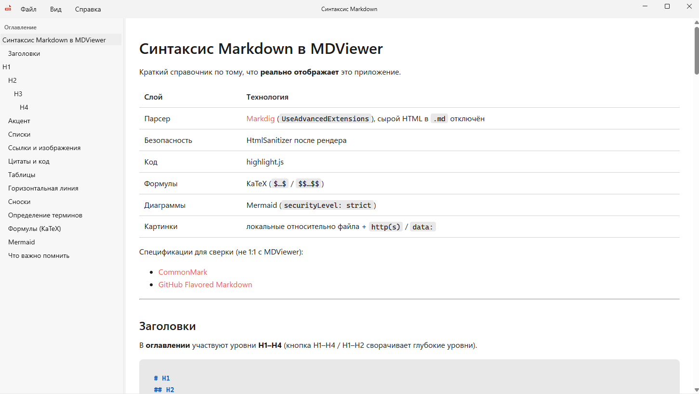

# MDViewer

Просмотр Markdown для Windows (WinUI 3, win-x64).
Открывает `.md` / `.markdown` с подсветкой кода, формулами KaTeX, диаграммами Mermaid, оглавлением, поиском и экспортом в PDF.

## Возможности

- Markdig (GFM-расширения), без выполнения сырого HTML (HtmlSanitizer)
- highlight.js, KaTeX, Mermaid (lazy, strict)
- Оглавление H1–H4 с контекстным меню
- Поиск по документу (`Ctrl+F`)
- Локальные изображения, относительные ссылки на `.md`, якоря `#fragment`
- Печать и экспорт PDF
- Темы: системная / светлая / тёмная
- Ассоциации файлов (Open With), single-instance

## Требования

| Сборка | Нужно на ПК |
|--------|-------------|
| **self-contained** | Windows 10/11 x64, [WebView2 Runtime](https://developer.microsoft.com/microsoft-edge/webview2/) (обычно уже есть) |
| **framework-dependent** | то же + [.NET 10 Desktop Runtime x64](https://dotnet.microsoft.com/download/dotnet/10.0) |

Минимальная ОС: Windows 10 version 1809 (17763)+.

## Установка

1. Скачайте ZIP из [Releases](https://github.com/yurymikitchuk/MDViewer/releases/latest).
2. Распакуйте в любую папку (например `C:\Tools\MDViewer`).
3. Запустите `MDViewer.exe`.
4. При желании: «Справка» / ассоциации файлов через меню приложения.

## Сборки в релизе

| Файл | Описание | Размер ≈ |
|------|----------|----------|
| `MDViewer-*-win-x64-self-contained.zip` | Runtime .NET внутри | ~237 MB |
| `MDViewer-*-win-x64-framework-dependent.zip` | Нужен .NET 10 Desktop | ~161 MB |

## Синтаксис

Встроенная справка: **Справка → Синтаксис Markdown** (что реально поддерживает приложение).

## Стек

- .NET 10, WinUI 3 (Windows App SDK), WebView2  
- Markdig, HtmlSanitizer, highlight.js, KaTeX, Mermaid  

## Лицензия

MIT — см. [LICENSE](LICENSE).
