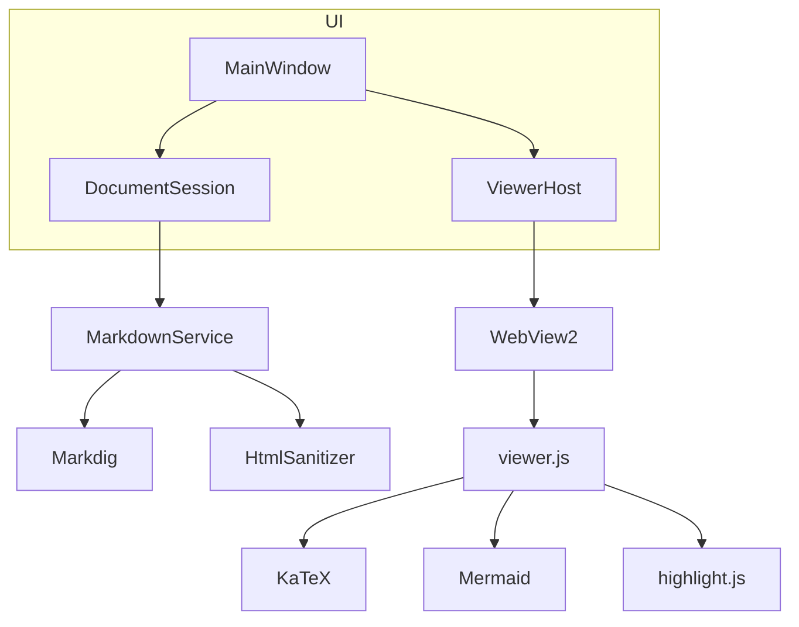
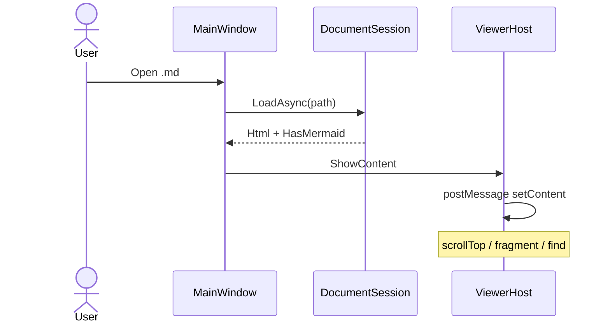
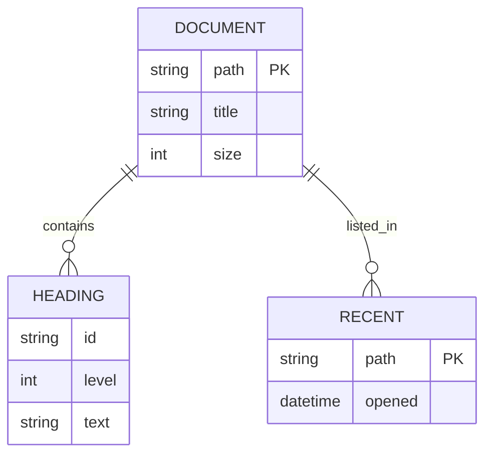
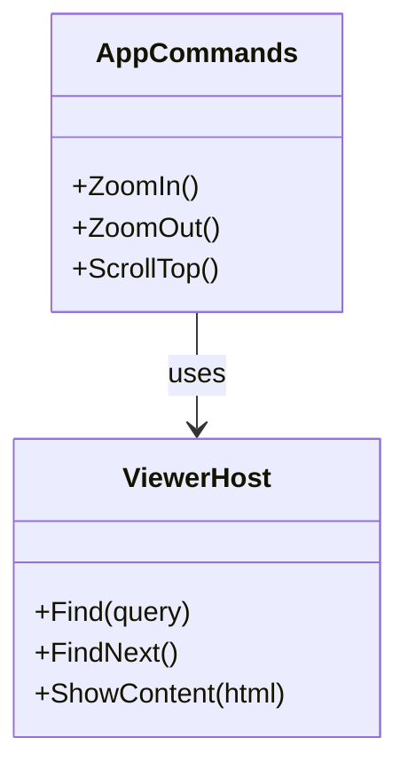
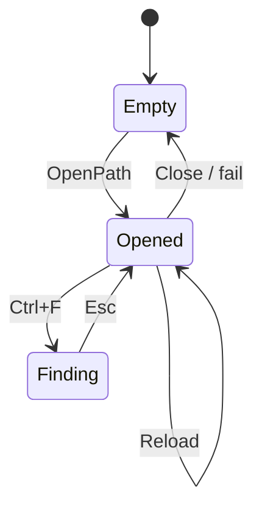

# MDViewer — сложный тестовый документ

Файл для ручной проверки: **TOC H1–H4**, поиск, zoom, тема, Mermaid, KaTeX, highlight.js, таблицы, списки, ссылки.

Ключевые слова для Find: `αβγ`, `needle-unique-42`, `Категорный`, `findmeONCE`.

---

## 1. Типографика и инлайны

Обычный абзац с **жирным**, *курсивом*, ***жирным курсивом***, ~~зачёркнутым~~, ==выделением==, `inline code`, ссылкой [example.com](https://example.com) и автоссылкой <https://example.org/path?q=1&x=2>.

Спецсимволы и юникод: © ® ™ — тире — длинное — кавычки «ёлочки» “лапки”, стрелки → ← ↔, математика в тексте $E=mc^2$, греческое αβγ, эмодзи если шрифт позволяет 🚀 📄 ✅.

Жёсткий разрыв строки  
вторая строка того же абзаца.

### 1.1. Сноски и сокращения

Текст со сноской[^note1] и ещё одной[^note2].

*[TOC]: Table of Contents
*[GFM]: GitHub Flavored Markdown

В этом абзаце встречаются TOC и GFM как аббревиатуры (если Markdig их раскрыл).

### 1.2. Определение

Term A
: Определение A — первая строка.
: Второе определение для того же термина.

MDViewer
: WinUI 3 просмотрщик Markdown с WebView2.

---

## 2. Списки и задачи

### 2.1. Маркированный и вложенный

- Уровень 1
  - Уровень 2
    - Уровень 3
      - Уровень 4
  - Сосед на 2
- Снова 1 с **разметкой** и `code`

### 2.2. Нумерованный

1. Первый
2. Второй
   1. Вложенный 2.1
   2. Вложенный 2.2
3. Третий — `needle-unique-42` спрятан здесь для поиска

### 2.3. Task list (GFM)

- [x] Открыть файл
- [x] Проверить TOC
- [ ] Найти `findmeONCE` через Find
- [ ] Переключить тему Light / Dark
- [ ] Zoom In / Out / Reset
- [ ] Печать / PDF (если нужно)

---

## 3. Цитаты

> Внешняя цитата первого уровня.
>
> > Вложенная цитата.
> >
> > Ещё строка внутри.
>
> Снова первый уровень, со списком:
>
> 1. пункт A
> 2. пункт B

---

## 4. Таблицы

### 4.1. Простая pipe-таблица

| Функция        | Статус | Заметка              |
| -------------- | :----: | -------------------- |
| Tables         |   ✅   | GFM pipe             |
| Task lists     |   ✅   | чекбоксы             |
| Autolink       |   ✅   | https://example.com  |
| Math           |   ✅   | KaTeX                |
| Mermaid        |   ✅   | flowchart / er / seq |
| Raw HTML       |   ❌   | DisableHtml          |

Выравнивание колонок: слева / центр / справа.

| Left     | Center | Right |
| :------- | :----: | ----: |
| alpha    |  mid   |  1.00 |
| beta     |  mid   | 12.50 |
| Категорный | mid  | 999.9 |

### 4.2. Широкая таблица (горизонтальный скролл)

| Col01 | Col02 | Col03 | Col04 | Col05 | Col06 | Col07 | Col08 | Col09 | Col10 |
| ----- | ----- | ----- | ----- | ----- | ----- | ----- | ----- | ----- | ----- |
| a1    | a2    | a3    | a4    | a5    | a6    | a7    | a8    | a9    | a10   |
| b1    | b2    | b3    | b4    | b5    | b6    | b7    | b8    | b9    | b10   |
| c1    | c2    | c3    | c4    | c5    | c6    | c7    | c8    | c9    | c10   |

---

## 5. Код (highlight.js)

### 5.1. C#

```csharp
using System;
using System.Collections.Generic;
using System.Linq;

namespace Samples;

public sealed class KitchenSink
{
    public static IEnumerable<int> Odds(IEnumerable<int> source) =>
        source.Where(n => n % 2 != 0);

    public static void Main()
    {
        var values = Odds(Enumerable.Range(1, 20)).ToArray();
        Console.WriteLine(string.Join(", ", values));
    }
}
```

### 5.2. TypeScript / JS

```ts
type Point = { x: number; y: number };

export function distance(a: Point, b: Point): number {
  const dx = a.x - b.x;
  const dy = a.y - b.y;
  return Math.hypot(dx, dy);
}

console.log(distance({ x: 0, y: 0 }, { x: 3, y: 4 })); // 5
```

### 5.3. Python

```python
from dataclasses import dataclass

@dataclass
class Doc:
    path: str
    size: int

def load(path: str) -> Doc:
    # комментарий и строка findmeONCE в коде
    return Doc(path=path, size=42)
```

### 5.4. JSON / YAML / SQL / PowerShell

```json
{
  "app": "MDViewer",
  "features": ["toc", "find", "mermaid", "katex"],
  "maxRecent": 8
}
```

```yaml
name: complex-kitchen-sink
tags:
  - smoke
  - mermaid
  - math
```

```sql
SELECT d.Title, COUNT(*) AS Opens
FROM Documents d
JOIN Recent r ON r.Path = d.Path
WHERE d.Title LIKE N'%тест%'
GROUP BY d.Title
ORDER BY Opens DESC;
```

```powershell
Get-ChildItem -Path 'd:\CURSOR\MDViewer\samples' -Filter *.md |
  Select-Object Name, Length |
  Format-Table -AutoSize
```

### 5.5. Без языка и длинная строка

```
plain fence — no highlighting
XXXXXXXXXXXXXXXXXXXXXXXXXXXXXXXXXXXXXXXXXXXXXXXXXXXXXXXXXXXXXXXXXXXXXXXXXXXXXXXXXXXXXXXXXXXXXXXXXXXX
```

---

## 6. Математика (KaTeX)

Инлайн: вероятность $P(A \mid B) = \frac{P(B \mid A)\,P(A)}{P(B)}$, сумма $\sum_{i=1}^{n} i = \frac{n(n+1)}{2}$.

Блок:

$$
\begin{aligned}
\nabla \times \mathbf{E} &= -\frac{\partial \mathbf{B}}{\partial t} \\
\nabla \times \mathbf{B} &= \mu_0\mathbf{J} + \mu_0\varepsilon_0\frac{\partial \mathbf{E}}{\partial t}
\end{aligned}
$$

Ещё один блок:

$$
\int_{-\infty}^{\infty} e^{-x^2}\,dx = \sqrt{\pi}
$$

---

## 7. Диаграммы Mermaid

### 7.1. Flowchart



### 7.2. Sequence



### 7.3. ER diagram



### 7.4. Class / state (доп. покрытие)





---

## 8. Глубокая иерархия для TOC

### 8.1. Раздел H3

#### 8.1.1. Раздел H4 alpha

Текст под H4. Якорь должен попадать в TOC при уровне H1–H4.

#### 8.1.2. Раздел H4 beta

Ещё один H4 для проверки фильтра «только H1–H2».

### 8.2. Соседний H3

Короткий абзац. Ссылка на [типографику](#1-типографика-и-инлайны) и на [Mermaid flowchart](#71-flowchart).

---

## 9. Ссылки между документами

Относительные (откроются в MDViewer, если файлы рядом):

- [gfm-smoke.md](./gfm-smoke.md)
- [test.md](./test.md)
- якорь в этом файле: [к математике](#6-математика-katex)

Внешние:

- [Markdig](https://github.com/xoofx/markdig)
- [Mermaid](https://mermaid.js.org/)

«Опасная» картинка (должна быть отфильтрована санитайзером / StripDangerousImages):

)

---

## 10. Длинный текст для скролла и поиска

Lorem markdown dolor sit amet, consectetur adipiscing elit. Повторяющееся слово **scroll** scroll scroll — проверьте, что Find показывает счётчик совпадений и ↑↓ ходит по кругу.

Параграф 1: The quick brown fox jumps over the lazy dog. Съешь же ещё этих мягких французских булок, да выпей чаю.

Параграф 2: Повторим αβγ один раз в середине длинного текста, чтобы найти греческую последовательность.

Параграф 3: Здесь нет уникального маркера, только шум: foo bar baz qux quux corge grault garply waldo fred plugh xyzzy thud.

Параграф 4: Вторая копия scroll для стресс-теста подсветки mark.md-find при живом поиске.

Параграф 5: Конец длинного блока. Если вы доскроллили сюда вручную — вертикальный скролл жив.

---

## 11. Горизонтальные линии и финал

Выше и ниже — `---`.

---

### Чеклист ручной проверки

1. TOC показывает H1–H4; режим H1–H2 скрывает §8.1.1 / §8.1.2.
2. Find: `needle-unique-42` → 1 совпадение; `scroll` → несколько; пустой запрос не пишет «Нет совпадений».
3. Тема Dark/Light: код, таблицы, Mermaid, формулы читаемы.
4. Zoom: Ctrl+колесо и меню Вид.
5. Клик по [gfm-smoke.md](./gfm-smoke.md) открывает соседний файл; Назад по истории — если появится.
6. Печать не тащит тёмный фон страницы (если проверяете print CSS).

[^note1]: Первая сноска — проверка footnotes Markdig.
[^note2]: Вторая сноска со ссылкой на <https://commonmark.org/>.
