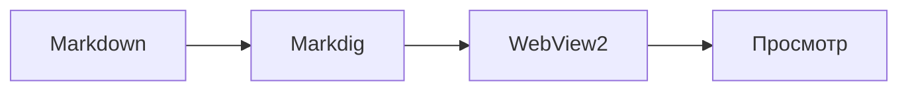
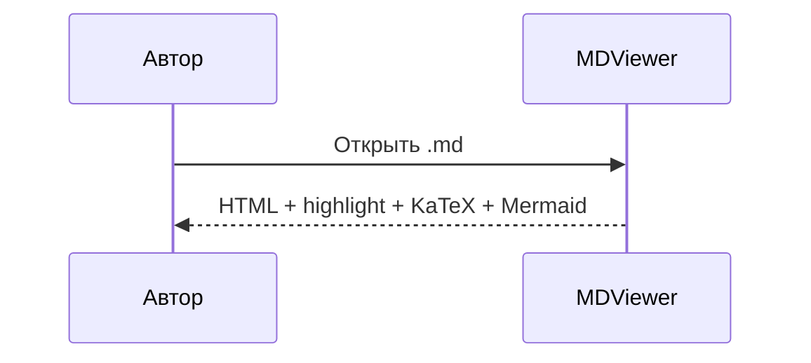

# Синтаксис Markdown в MDViewer

Краткий справочник по тому, что **реально отображает** это приложение.

| Слой | Технология |
| ---- | ---------- |
| Парсер | [Markdig](https://github.com/xoofx/markdig) (`UseAdvancedExtensions`), сырой HTML в `.md` отключён |
| Безопасность | HtmlSanitizer после рендера |
| Код | highlight.js |
| Формулы | KaTeX (`$…$` / `$$…$$`) |
| Диаграммы | Mermaid (`securityLevel: strict`) |
| Картинки | локальные относительно файла + `http(s)` / `data:` |

Спецификации для сверки (не 1:1 с MDViewer):

- [CommonMark](https://commonmark.org/)
- [GitHub Flavored Markdown](https://github.github.com/gfm/)

---

## Заголовки и оглавление

В оглавлении участвуют уровни **H1–H4**. Глубину списка выбирают в **контекстном меню панели оглавления** (ПКМ по TOC):

- Только H1  
- H1–H2  
- H1–H3  
- H1–H4  

Там же: переход к началу / текущему разделу, копирование оглавления или ссылки на заголовок, ширина панели, скрыть оглавление. Выбор уровня и ширины сохраняется.

```markdown
# H1
## H2
### H3
#### H4
```

# H1
## H2
### H3
#### H4

---

## Акцент

```markdown
*курсив* и _тоже курсив_
**жирный** и __тоже жирный__
***жирный курсив***
~~зачёркнутый~~
==выделение==
```

*курсив* и _тоже курсив_  
**жирный** и __тоже жирный__  
***жирный курсив***  
~~зачёркнутый~~  
==выделение==

---

## Списки

```markdown
- пункт
  - вложенный
1. первый
2. второй
- [ ] задача
- [x] готово
```

- пункт
  - вложенный
1. первый
2. второй
- [ ] задача
- [x] готово

---

## Ссылки и изображения

```markdown
[текст](https://example.com)
[раздел в другом файле](./notes.md#heading-id)

Автоссылка: <https://example.com>
```

[текст](https://example.com)  
Автоссылка: <https://example.com>

- Относительные ссылки на `.md` открываются в MDViewer; можно указать якорь `#id`.
- Якоря `#…` в текущем документе (и в CLI / ассоциации файлов) прокручивают к заголовку.
- **Локальные изображения** (`./img.png`, `images/a.png`) подгружаются из папки документа.
- Внешние `https://…` тоже работают.

---

## Цитаты и код

> Цитата  
> может быть многострочной

Инлайн: `` `код` `` → `инлайн-код`

Блоки с языком подсвечиваются (**highlight.js**):

````markdown
```csharp
Console.WriteLine("блок кода");
```

```js
const n = 42;
```

```python
print("hello")
```
````

```csharp
Console.WriteLine("блок кода");
```

```js
const n = 42;
```

```python
print("hello")
```

Тема подсветки следует светлой/тёмной теме приложения.

---

## Таблицы

```markdown
| Колонка | Значение |
| ------- | -------- |
| A       | 1        |
| B       | 2        |
```

| Колонка | Значение |
| ------- | -------- |
| A       | 1        |
| B       | 2        |

Широкие таблицы можно прокручивать по горизонтали.

---

## Горизонтальная линия

```markdown
---
```

---

## Сноски

```markdown
Текст со сноской.[^1]

[^1]: Текст сноски.
```

Текст со сноской.[^1]

[^1]: Текст сноски.

---

## Определение терминов

```markdown
MDViewer
:   Просмотрщик Markdown для Windows.
```

MDViewer
:   Просмотрщик Markdown для Windows.

---

## Формулы (KaTeX)

Инлайн: `$E = mc^2$` → $E = mc^2$

Блок:

$$
\sum_{i=1}^{n} i = \frac{n(n+1)}{2}
$$

Синтаксис Markdig: `$…$` / `$$…$$` на отдельных строках для блока. Рендер — **KaTeX**.

---

## Mermaid

Блок `mermaid` рисуется встроенным движком (lazy-load). Текст документа показывается сразу; схемы дорисовываются по одной (с таймаутом), чтобы тяжёлые файлы не «зависали» на пустом экране.





Типичные типы: flowchart, sequence, class, er, state и др. Режим безопасности: **strict** (без HTML-подписей в flowchart). При смене темы диаграммы перерисовываются. В ER-диаграммах кириллические имена нормализуются автоматически.

---

## Поиск, масштаб, копирование

| Действие | Как |
| -------- | --- |
| Найти | `Ctrl+F` / меню «Правка → Найти» |
| Поиск | по мере ввода; Enter / ↓ — следующее, Shift+Enter / ↑ — предыдущее; Esc — закрыть |
| Статус | `N / M` или «Нет совпадений»; пустое поле не считается «нет совпадений» |
| Масштаб | «Вид → Увеличить / Уменьшить / Сбросить» или Ctrl+колесо; значение сохраняется |
| Копировать | «как текст» и «как HTML» — **весь документ** (не только выделение) |

---

## Что важно помнить

1. **Сырой HTML** в `.md` не выполняется; после Markdig HTML проходит HtmlSanitizer.
2. **Тема** (системная / светлая / тёмная) влияет на документ, chrome и подсветку кода; **печать и PDF** всегда в светлой схеме.
3. **Кодировка файла:** UTF-8 (в т.ч. BOM), иначе Windows-1251 / системная ANSI.
4. Относительные **картинки** и **.md-ссылки** работают от папки открытого файла.
5. На стартовом экране — до **8 недавних файлов**; полный список — «Файл → Недавние файлы».
6. Этот файл — встроенная справка (`Справка → Синтаксис Markdown`), в «Недавние» не попадает.
7. Лимит размера файла для открытия: **12 МБ**.
8. Для «как у GitHub» смотрите GFM; спорные места проверяйте именно в MDViewer.
